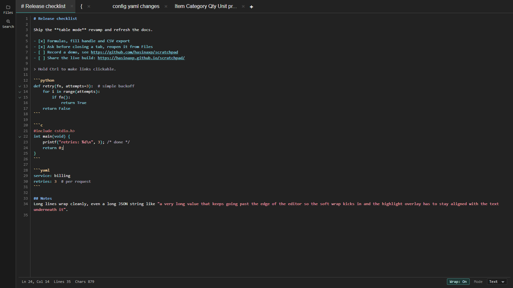
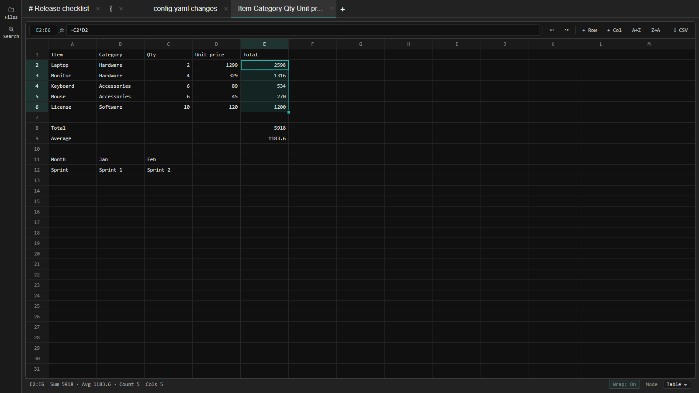
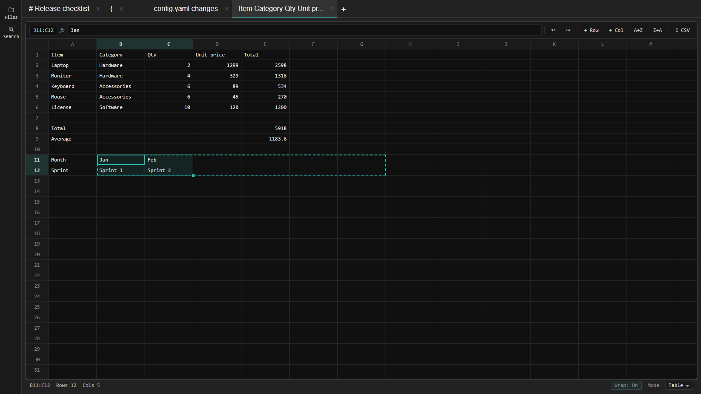
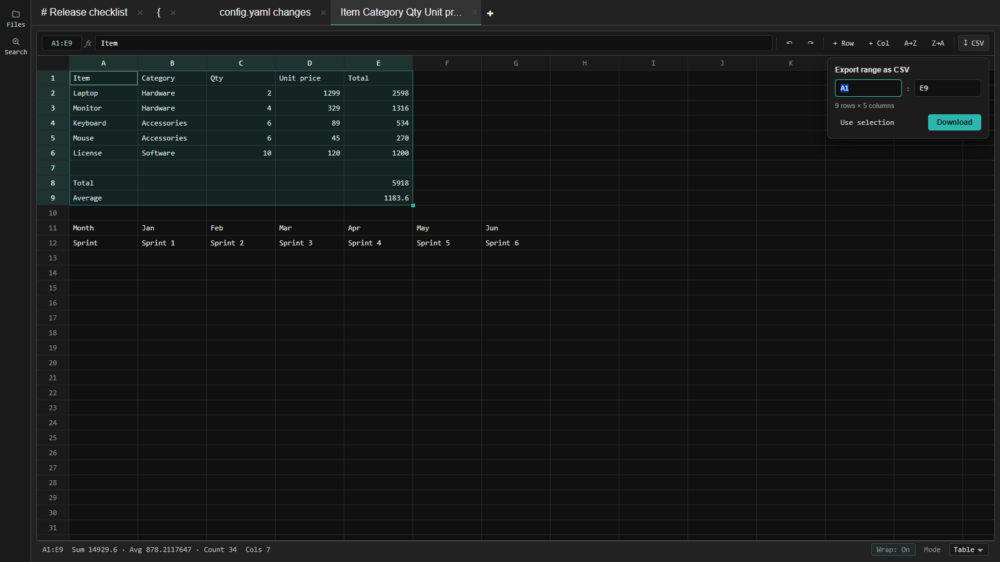
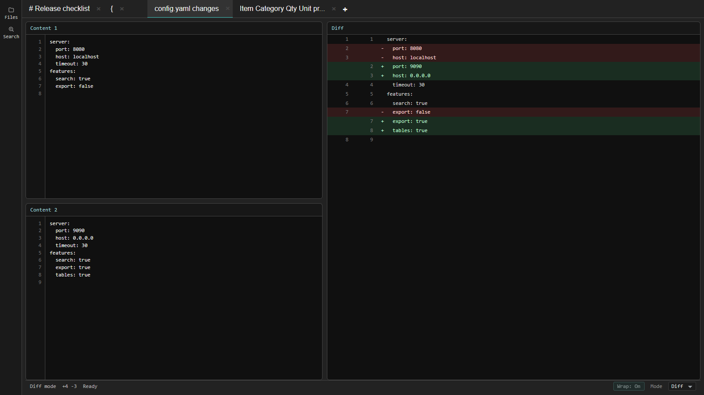
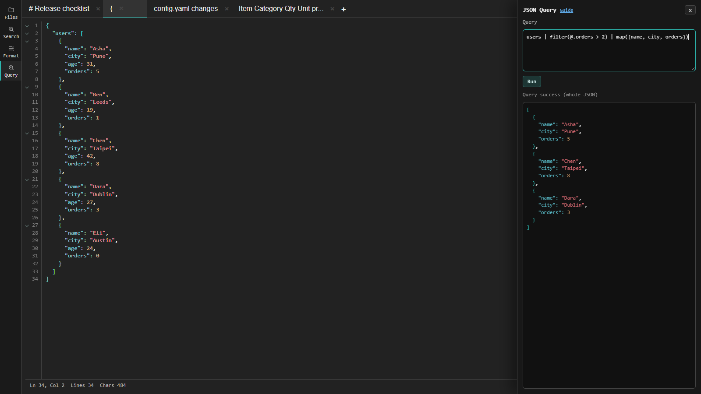
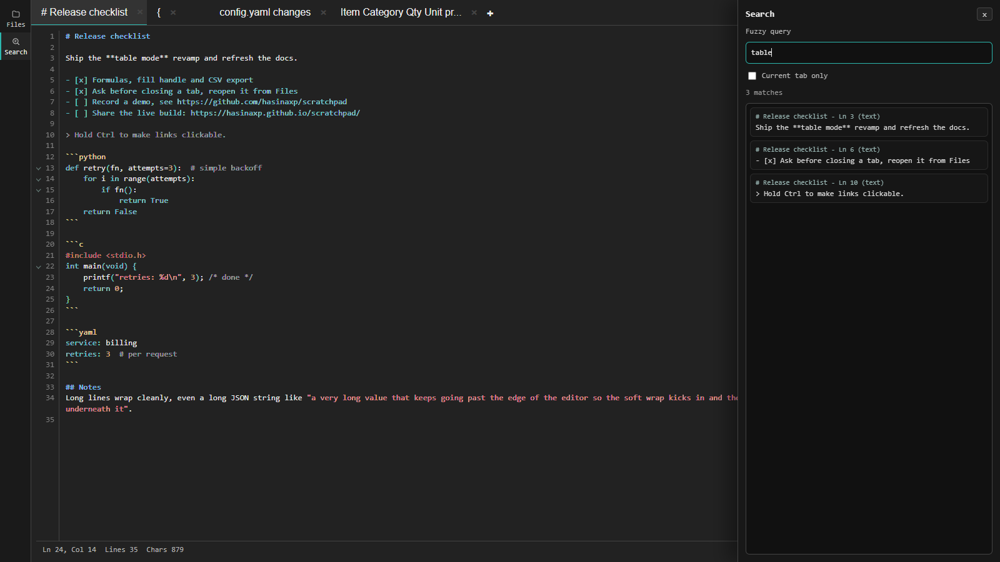
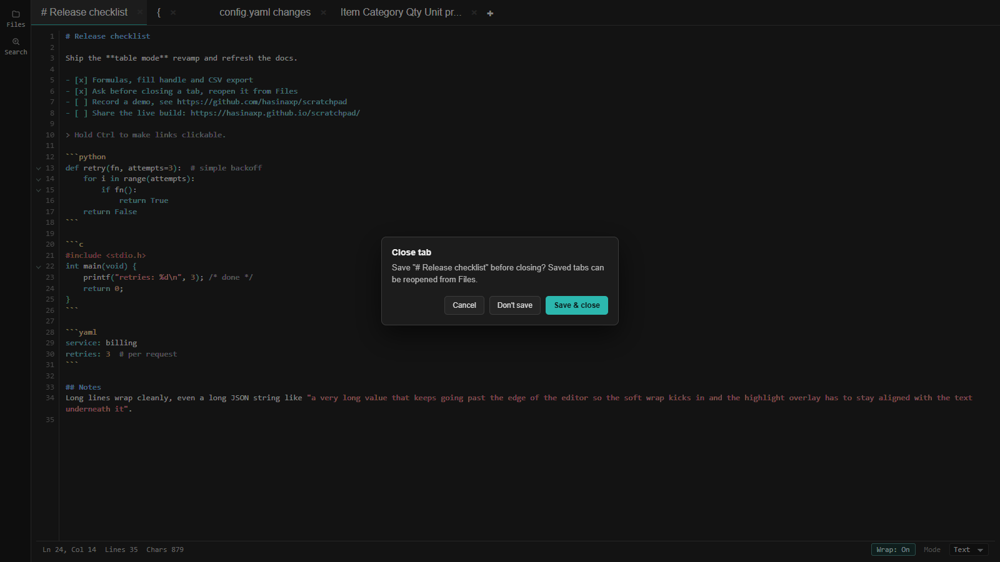
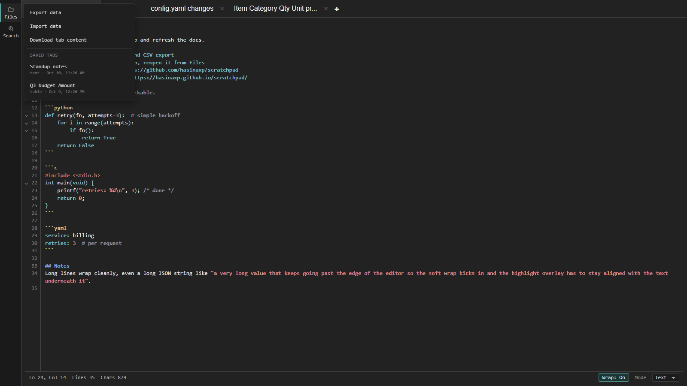

# scratchpad

scratchpad is a browser-only editor for day-to-day notes, code snippets, JSON workflows, spreadsheets and quick text transforms.

There is no backend. Your data stays in your browser and is persisted in IndexedDB.

## Highlights

- Multi-tab editing with local persistence
- Mode-based tabs (`text`, `json`, `diff`, `table`)
- Closing a tab asks whether to save it; saved tabs can be reopened later from **Files**
- Syntax highlighting for text (Markdown) and JSON, plus fenced code blocks in `python`, `java`, `yaml`, `json` and `c`
- Links in the editor become clickable while `Ctrl` is held (they open in a new tab)
- Soft wrap that keeps highlighting aligned, even for long wrapped strings
- Spreadsheet-style table mode (see below)
- Dedicated diff mode with side-by-side inputs and GitHub-style unified output
- Fuzzy search across all tabs, or only the current tab, with jump-to-result
- VS Code-style find/replace (regex, case, whole-word, replace one/all)
- Folding support (brace + indentation), gutter indicators, and fold toggles
- Decode tools (URL, Unicode escape, JWT header/payload, escaped string)
- JSON formatting tools (pretty/minified)
- JSON Query panel with [JPL](JPL.md) pipelines
- Undo/redo with bounded history for predictable memory use

## Table mode

Switch a tab's mode to **Table** to get a spreadsheet:

- **Endless sheet**: rows and columns keep growing as you scroll; only the visible cells are rendered
- **Formulas**: start a cell with `=`. It supports `+ - * / ^ & %`, comparisons, cell references (`A1`, `$A$1`) and ranges (`A1:B5`)
- **Functions**: `SUM`, `AVERAGE`, `MIN`, `MAX`, `COUNT`, `COUNTA`, `ROUND`, `ABS`, `SQRT`, `POWER`, `MOD`, `IF`, `IFERROR`, `AND`, `OR`, `NOT`, `CONCAT`, `LEN`, `UPPER`, `LOWER`, `TRIM`
- **Fill handle**: drag the square at the selection corner to project a series: numbers follow their trend (`2, 4` → `6, 8`), `Item 1` → `Item 2`, months and weekdays, ISO dates, and formulas with shifted references. Double-click the handle to fill down beside existing data
- **Move cells**: drag a selection by its border; formulas that point at the moved cells follow them
- **Formula bar** with the cell name, plus Sum/Avg/Count of the selection in the status bar
- **Copy/paste** with Excel and Google Sheets (TSV); copying inside the sheet keeps formulas
- **Rows and columns**: insert or delete them from the right-click menu; references adjust automatically
- **Sort**, **fill down/right**, **column resize**, and **undo/redo** per tab
- **CSV export** of any range: enter two corner cells (for example `A1` and `E9`), or use the current selection
- Opening CSV or TSV text in table mode handles quoted fields

## Keyboard Shortcuts

### Editor

- `Ctrl+S`: Open fuzzy search
- `Ctrl+F`: Open Find
- `Ctrl+H`: Open Find and Replace
- `Ctrl+W`: Close tab (asks to save if it has content)
- `Ctrl+T`: New tab
- `Ctrl` + click: Open the link under the cursor in a new tab
- `Ctrl+Z`: Undo
- `Ctrl+Y`: Redo
- `Ctrl+Shift+[` : Fold current block
- `Ctrl+Shift+]` : Unfold current block (or unfold all)
- `Alt+ArrowUp / Alt+ArrowDown`: Move selected line block up/down
- `Shift+Alt+ArrowUp / Shift+Alt+ArrowDown`: Duplicate selected line block up/down
- `Ctrl+Shift+K`: Delete selected line block
- `Ctrl+Enter`: Insert line below (preserve indentation)
- `Ctrl+Shift+Enter`: Insert line above (preserve indentation)
- `Ctrl+C` (no selection): Copy current line
- `Ctrl+X` (no selection): Cut current line
- `Tab`: Indent cursor/selection
- `Shift+Tab`: Outdent cursor/selection
- `Ctrl+/`: Toggle line comment for current line/selection
- `Ctrl+D`: Duplicate selection (or current line)
- `Ctrl+L`: Select current line

### Table

- Type to replace a cell; `Enter`, `F2` or double-click to edit it; `Esc` cancels
- `Enter` / `Tab` (while editing): Commit and move down / right
- `Arrow keys`: Move; `Shift+Arrow` extends the selection; `Ctrl+Arrow` jumps to the edge of the data
- `Home` / `End`, `Ctrl+Home` / `Ctrl+End`: Row start/end, sheet start / end of data
- `Ctrl+A`: Select all
- `Ctrl+C` / `Ctrl+X` / `Ctrl+V`: Copy / cut / paste
- `Ctrl+D` / `Ctrl+R`: Fill down / fill right
- `Ctrl+Z` / `Ctrl+Y`: Undo / redo
- `Ctrl+E`: Export a range as CSV
- `Delete`: Clear selection
- `Shift+F10` or right-click: Actions menu

## Run

Visit: [https://hasinaxp.github.io/scratchpad/](https://hasinaxp.github.io/scratchpad/)

Or run locally with any static file server, since browsers block ES modules on `file://` pages:

```sh
python -m http.server 8000
# then open http://localhost:8000
```

## Tests

The formula engine, series fill and syntax highlighter have unit tests (Node 18+):

```sh
npm test
```

## Screenshots

### Editor

Markdown notes with highlighted Python, C and YAML code blocks; links are underlined while `Ctrl` is held.



### Table Mode

Formulas, a formula bar and live Sum/Avg/Count of the selection.



Dragging the fill handle projects `Jan, Feb` and `Sprint 1, Sprint 2` across the row.



Exporting a range as CSV.



### Diff Mode



### JSON Query Panel



### Fuzzy Search



### Closing and Reopening Tabs




